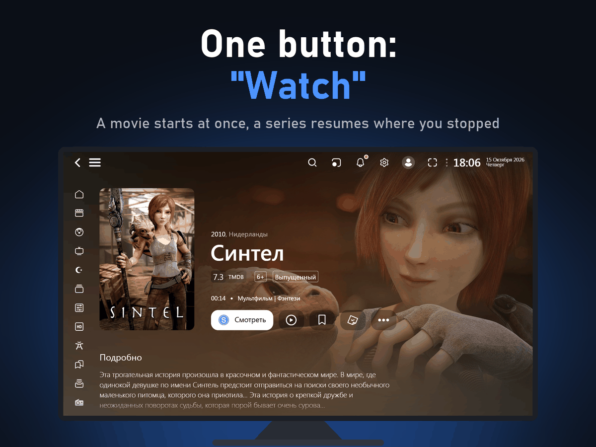
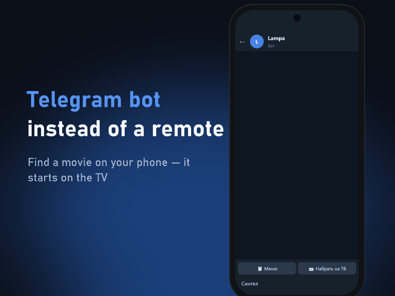
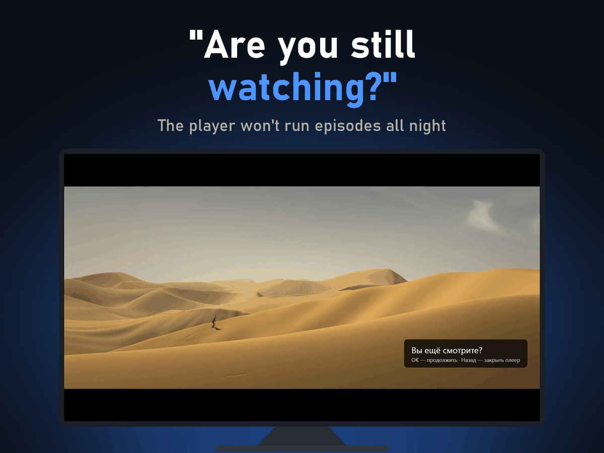
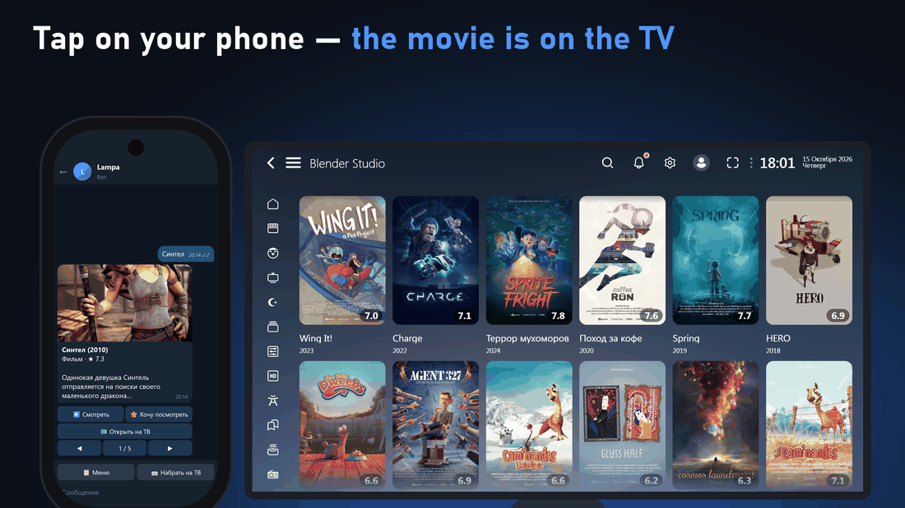
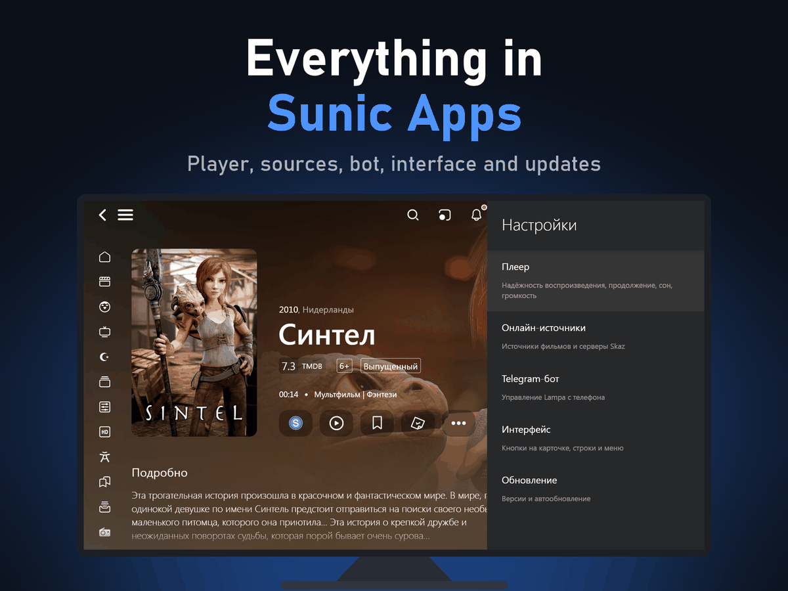
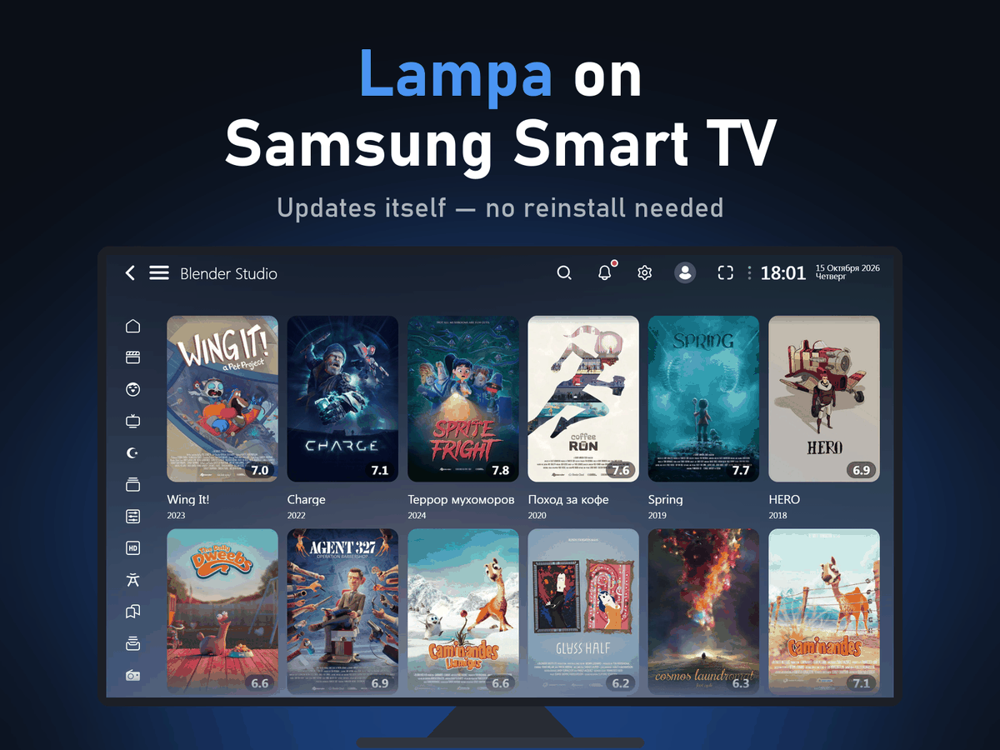
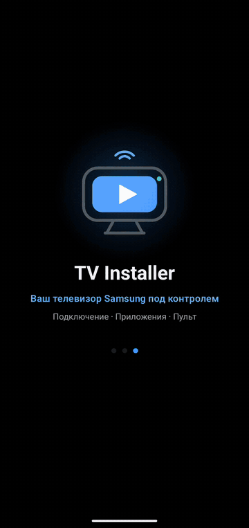
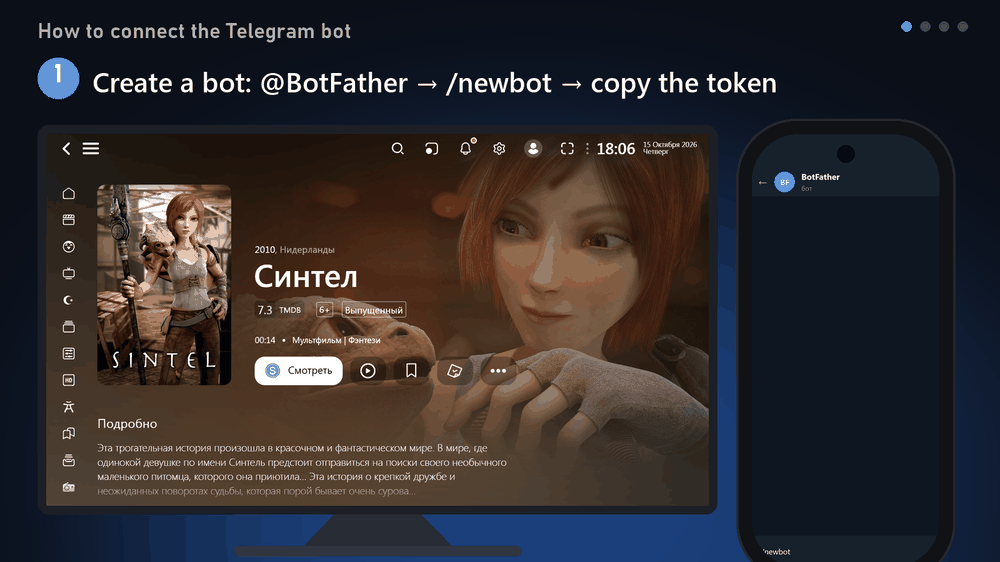

<picture></picture>

The open-source <b>Lampa</b> media center — on any Smart TV, Android and in the browser; the most complete version is for <b>Samsung Smart TV</b>. Updates itself, keeps the player from freezing and adds a Telegram bot.

<picture></picture>
<picture></picture>

&nbsp;&nbsp;&nbsp;&nbsp;&nbsp;<picture></picture> <b>English</b>&nbsp;&nbsp;&nbsp;<a href="README.ru.md"> Русский</a>&nbsp;&nbsp;&nbsp;<a href="README.uz.md"> O'zbekcha</a>

Free · <a href="https://sunic.stream">sunic.stream</a> · Tizen 2.3+ · <a href="CHANGELOG.md">What's new</a> (RU) · <a href="../docs/DEVELOPMENT.md">For developers</a> (RU)

 

## Where it works

Lampa with Sunic Apps works on any platform. More — <a href="https://sunic.stream">sunic.stream</a>.

- <b>Samsung Smart TV</b> — the <code>samsung.wgt</code> app (installed with TV Installer or Tizen, see below). The most complete version: TV volume memory, the Smart Hub panel, sleep that closes the app, the TV player (AVPlay).
- <b>Any Smart TV</b> — Samsung, LG, Android TV and others — through the <b>Media Station X</b> app: <b>Settings → Start Parameter → Setup</b> → <code>sunic.stream</code>. No developer mode.
- <b>Android</b> — TV, boxes, phones: the plugin <code>https://sunic.stream/sunic.js</code> in Lampa (for example, Lampa BS) — see <a href="https://github.com/sunic007/lampa-android">lampa-android</a>.
- <b>Browser</b> — <a href="https://sunic.stream/lampa/">sunic.stream/lampa</a>. Skaz sources don't open in a browser (Skaz servers are http only, the page is https); Online Mod and Z01 work.

## How it works on Samsung

1. <b>Prepare the TV</b> — turn on Developer Mode with your phone's address (<a href="https://github.com/sunic007/tvinstaller">TV Installer</a> shows how).
2. <b>Install Lampa</b> — in TV Installer pick Lampa, or download <code>samsung.wgt</code> and install it with any installer that signs the package.
3. <b>Start Lampa</b> — the package applies the starter settings and then updates itself.
4. <b>Connect the Telegram bot</b> (optional) — <b>Settings → Sunic Apps → Telegram-бот</b>.

  <picture></picture>
  
  <picture></picture>
  <picture></picture>

<picture></picture>

<b>More screenshots</b>

 

  <picture></picture>
  <picture></picture>

Screenshots show only open movies by the Blender Foundation (Sintel, Spring, Wing It! and others), licensed under Creative Commons Attribution — © Blender Foundation | studio.blender.org. No copyrighted content is shown.

## Install and connect

  <picture></picture>
  <picture></picture>

Left — installing Lampa with TV Installer, right — connecting the Telegram bot.

<b>TV Installer</b> is the easiest way to install Lampa: the Android app finds your TV, gets the Samsung certificate and installs the latest version. No PC needed. 
<a href="https://github.com/sunic007/tvinstaller/releases/latest/download/SunicTvInstaller.apk"><b>Download TV Installer →</b></a>

 

## Features

- <b>One-press “Watch”</b> — a movie starts at once, a series resumes from the episode and position you stopped at.
- <b>Telegram bot</b> — search on your phone and start on the TV, notifications about new episodes, the whole family in one bot, several TVs.
- <b>Player watchdog</b> — restarts a frozen video from the same position, then tries another quality or source — another source is found right in the player, without leaving it.
- <b>Auto-update</b> — Lampa, the plugins and the package update themselves — no reinstall. Before a Sunic Apps update a “what's new” window lets you update now or later.
- <b>Player auto-select</b> — the TV player (AVPlay) for hardware 4K/HLS; a stream it can't play goes to the Lampa player. Faster start, quality matched to your internet.
- <b>Cartoons and Turkish series</b> — own buttons in the left menu: cartoons by age and theme (turn on in <b>Sunic Apps → Интерфейс</b>), Turkish series by genre and year.
- <b>Comfort</b> — next-episode countdown, “Are you still watching?”, sleep timer, day/night brightness, per-title volume.
- <b>Works without the server</b> — a bundled copy of Lampa starts if the server is unavailable.
- <b>All in one place</b> — every package setting is in <b>Settings → Sunic Apps</b>.

<b>AI search for free.</b> No CUB subscription? Search by description and by screenshot in the bot works with a free key from <a href="https://console.groq.com/keys">Groq</a>, <a href="https://aistudio.google.com/apikey">Gemini</a> or <a href="https://openrouter.ai/keys">OpenRouter</a> — just send the key to the bot.

 

The Telegram bot speaks English, Russian and Uzbek and follows the Lampa language; the package's settings on the TV are in Russian. The full feature table is in the <a href="README.ru.md#возможности">Russian README</a>.

<b>Package settings</b>

 

All package settings are in one section, <b>Settings → Sunic Apps</b> (the names on the TV are in Russian). Lampa's own sections stay as they are; to protect from adult content use Lampa's parental control and the CUB kids profile.
- <b>Плеер</b> (Player) — reliability: player auto-select, player watchdog, quality matched to your internet, TV player buffer; while watching: “continue or start over”, skip the ad before a movie, Skaz skip marks (automatic or by button — in Lampa's player menu “Сегменты”), remember the series audio track, next-episode countdown, “Are you still watching?”, sleep timer, per-title volume, “not louder at night”;
- <b>Онлайн-источники</b> (Online sources) — auto source pick, check sources in advance, torrents (show “Парсер” and “TorrServer”), Skaz source servers: current ones with ping, auto-select, check and manual choice; other sources to choose: the main source for “Смотреть” (Watch), Z01, Online Mod, VOD (llpp.in), Showy, Vod (arkmv);
- <b>Telegram-бот</b> (Telegram bot) — connecting (QR from the phone, a code on the screen for a second TV, or the token by hand), the TV's name, disconnect; new episodes in Telegram, Shots recordings to Telegram, the bot's QR in search, check now; people and access: new people only with your approval, guests can start videos on the TV, change the invite;
- <b>Интерфейс</b> (Interface) — the “Смотреть” (Watch) button on the card, “Watch” resumes from the position, a movie starts in Russian at once, the “Турецкие сериалы” (Turkish series) and “Мультики” (Cartoons) menu buttons, new episodes;
- <b>Обновление</b> (Update) — Lampa version and “update Lampa automatically”, Skaz plugins, Sunic Apps version and “update from GitHub”, “Проверить и обновить” (check and update); “Поддержать проект” (support the project) — a QR code for GitHub Sponsors.

## Content sources

The package contains no movies, series or streams. What you watch depends on the content source you connect yourself — for example the <a href="https://skaz.tv">Skaz TV</a> subscription the package is set up for (subscription: <a href="https://skaz.tv/oplata.php">skaz.tv/oplata.php</a>, support: <a href="https://t.me/helpiptv">@helpiptv</a>). Use only sources you have the right to use.

## FAQ

<b>The video does not start</b>

 

Wait: if it hasn't started in 25 s (2 s after a player error) the package restarts the stream or opens another variant. If nothing works, check your <a href="https://skaz.tv">Skaz TV</a> subscription and contact its support: <a href="https://t.me/helpiptv">@helpiptv</a>.

<b>The video starts in 720p although 1080p/4K is available</b>

 

That is “quality matched to your internet”: by the player's measurements your connection can't carry a higher quality. You can switch it in the player (green button) or turn the feature off in <b>Sunic Apps → Плеер</b>.

<b>Stuck on “Подготовка” (Preparing)</b>

 

The bottom of the screen shows which step Lampa is waiting for; on a poor connection the start can take 1–2 minutes.

<b>How do I continue a movie from my phone on the TV?</b>

 

Sign in to the same CUB account on both devices → in the phone's player tap “Share” → pick the TV → on the TV answer “Yes”.

<b>How do I know it updated?</b>

 

Before a Sunic Apps update (the package's own features) a window “Вышло обновление” (“Update available”) shows “Sunic Apps: X → Y”, what's new, and the buttons “Обновить сейчас” (update now) / “Позже” (later — it is installed on the next start). “Lampa обновлена: X → Y” is about Lampa itself (the core from the byskaz server). Versions are in <b>Settings → Sunic Apps → Обновление</b>.

<b>Does it host movies?</b>

 

No. It is a player; it does not host, store or distribute any media.

## Data and privacy

This package adds no ads or analytics, and the developer receives none of your data. The Telegram bot runs on your TV: its token, the people you approved and your lists are stored only on the TV. Pairing a phone goes through the ntfy.sh relay, encrypted. Movie data comes from TMDB. AI search sends your description or screenshot only to the AI service whose key you added (Groq, Gemini or OpenRouter). Third-party online sources you turn on in Lampa run inside the app — enable only the ones you trust.

## Using this project

Want to use the package in your project, build, article or video? You are welcome to — please <b>keep a link to this repository</b>. I'd also be glad if you <b>let me know</b> (optional): write in the <a href="https://t.me/sunicapps">Telegram group</a> or open an <a href="https://github.com/sunic007/lampa-samsung/issues/new/choose">issue</a>. The code is under the MIT license (Lampa itself — its own license, see THIRD_PARTY_NOTICES).

## Support the project

Lampa for Samsung and TV Installer are free. If they help you, you can support development on <a href="https://github.com/sponsors/sunic007"><b>GitHub Sponsors</b></a> (in Lampa: <b>Settings → Sunic Apps → Обновление → Поддержать проект</b>).

---

This project does not host, store or distribute any films, series or other media and is not affiliated with the content services it can be used with. Samsung and Tizen are trademarks of Samsung Electronics; this project is not affiliated with or endorsed by Samsung. Telegram is a trademark of Telegram FZ-LLC; the project is not affiliated with Telegram. Movie data and images: <a href="https://www.themoviedb.org">TMDB</a> — this product uses the TMDB API but is not endorsed or certified by TMDB. Lampa is the <a href="https://github.com/yumata/lampa">yumata/lampa</a> project, plugins and server — <a href="https://lampabs.com">byskaz</a>; this package does not modify them. Third-party licenses — <a href="../licenses/THIRD_PARTY_NOTICES.md">THIRD_PARTY_NOTICES.md</a>.

