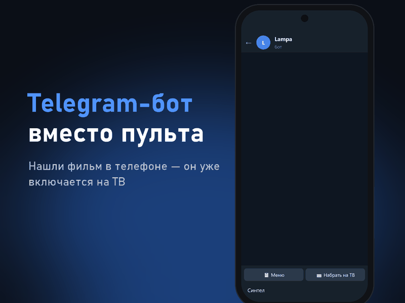
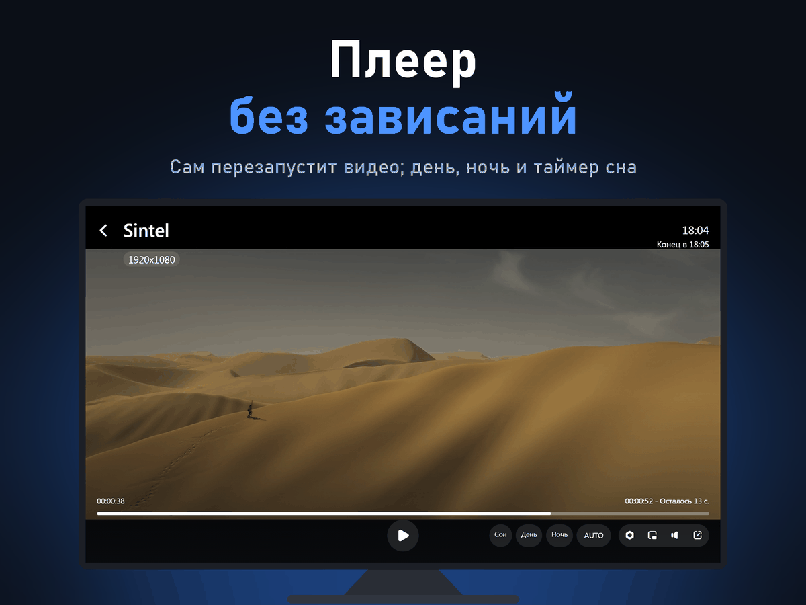
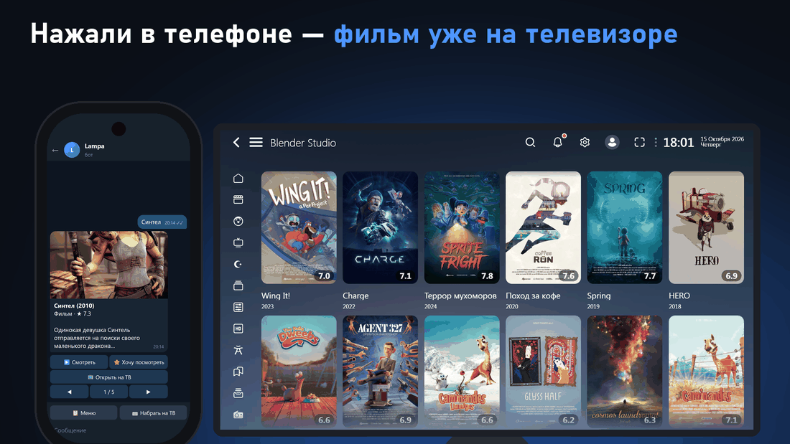
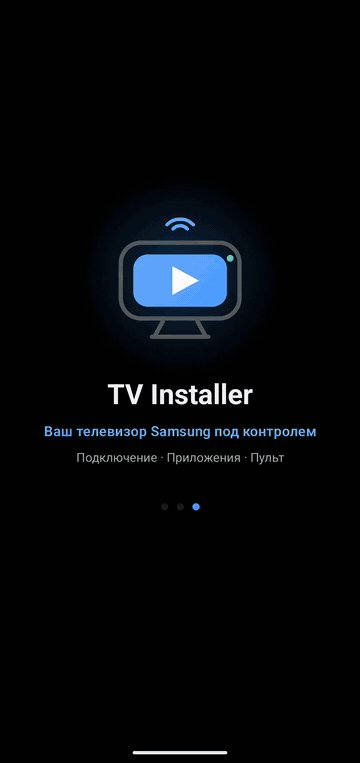
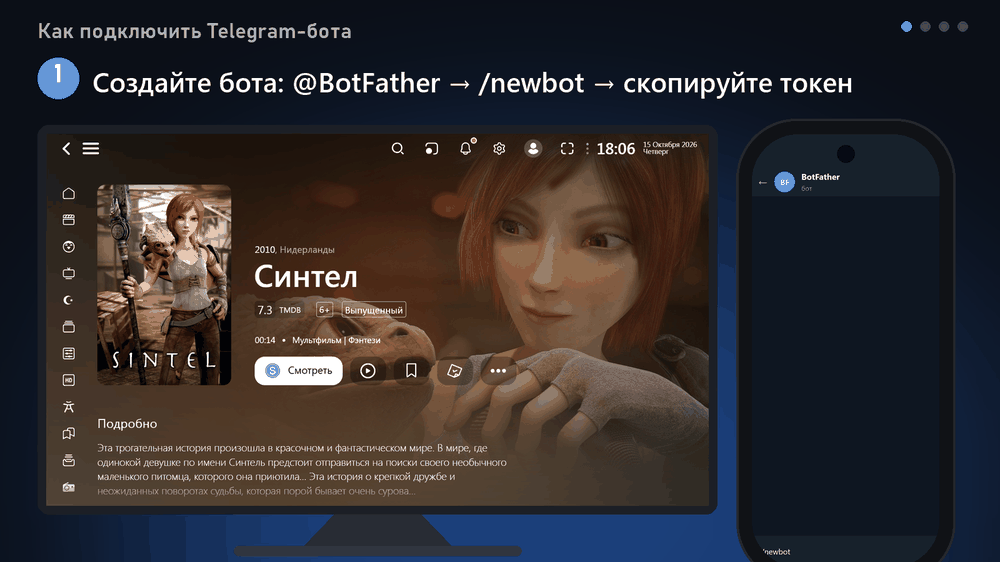

<picture></picture>

Открытый медиацентр <b>Lampa</b> — на любом Smart TV, Android и в браузере; самая полная версия — для <b>Samsung Smart TV</b>. Сам обновляется, не даёт плееру зависнуть и добавляет Telegram-бота.

<picture></picture>
<picture></picture>

&nbsp;&nbsp;&nbsp;&nbsp;&nbsp;<a href="README.md"> English</a>&nbsp;&nbsp;&nbsp;<picture></picture> <b>Русский</b>&nbsp;&nbsp;&nbsp;<a href="README.uz.md"> O'zbekcha</a>

Бесплатно · <a href="https://sunic.stream">sunic.stream</a> · Tizen 2.3+ · <a href="CHANGELOG.md">Что нового</a> · <a href="../docs/DEVELOPMENT.md">Для разработчиков</a>

 

## Где работает

Lampa с Sunic Apps работает на любой платформе. Подробнее — <a href="https://sunic.stream">sunic.stream</a>.

- <b>Samsung Smart TV</b> — приложение <code>samsung.wgt</code> (ставится через TV Installer или Tizen, см. ниже). Самая полная версия: память громкости ТВ, панель Smart Hub, сон с закрытием приложения, плеер ТВ (AVPlay).
- <b>Любой Smart TV</b> — Samsung, LG, Android TV и другие — через приложение <b>Media Station X</b>: <b>Settings → Start Parameter → Setup</b> → <code>sunic.stream</code>. Без режима разработчика.
- <b>Android</b> — ТВ, приставки, телефоны: плагин <code>https://sunic.stream/sunic.js</code> в Lampa (например, Lampa BS) — см. <a href="https://github.com/sunic007/lampa-android">lampa-android</a>.
- <b>Браузер</b> — компьютер, телефон, планшет: <a href="https://sunic.stream/lampa/">sunic.stream/lampa</a>, печатать можно с обычной клавиатуры, на планшете — управление касанием. В браузере источники Skaz не открываются (их серверы работают только по http, а страница — по https); Online Mod и Z01 работают.

## Как это работает на Samsung

1. <b>Подготовьте телевизор</b> — включите режим разработчика с адресом телефона (как — покажет <a href="https://github.com/sunic007/tvinstaller">TV Installer</a>).
2. <b>Установите Lampa</b> — в TV Installer выберите Lampa или скачайте <code>samsung.wgt</code> и установите любым установщиком, который подписывает пакет.
3. <b>Запустите Lampa</b> — стартовые настройки пакет поставит сам, дальше будет обновляться сам.
4. <b>Подключите Telegram-бота</b> (по желанию) — <b>Настройки → Sunic Apps → Telegram-бот</b>.

  <picture></picture>
  
  <picture></picture>
  <picture></picture>

<picture></picture>

<b>Ещё скриншоты</b>

 

  <picture></picture>
  <picture></picture>

На скриншотах — только открытые фильмы Blender Foundation (Sintel, Spring, Wing It! и другие) по лицензии Creative Commons Attribution — © Blender Foundation | studio.blender.org. Авторские права не нарушаются.

## Установка и подключение

  <picture></picture>
  <picture></picture>

Слева — установка Lampa через TV Installer, справа — подключение Telegram-бота.

<b>TV Installer</b> — самый простой способ поставить Lampa: приложение для Android само найдёт телевизор, получит сертификат Samsung и установит последнюю версию. Без компьютера. 
<a href="https://github.com/sunic007/tvinstaller/releases/latest/download/SunicTvInstaller.apk"><b>Скачать TV Installer →</b></a>

 

## Возможности

- <b>«Смотреть» одной кнопкой</b> — фильм сразу идёт, сериал — с той серии и места, где остановились.
- <b>Telegram-бот</b> — поиск в телефоне и запуск на ТВ, уведомления о новых сериях, вся семья в одном боте, несколько телевизоров.
- <b>Сторож плеера</b> — зависшее видео перезапускает с того же места, потом пробует другое качество или источник.
- <b>Автообновление</b> — Lampa, плагины и сам пакет обновляются сами — без переустановки.
- <b>Плеер Samsung (AVPlay)</b> — аппаратное 4K/HLS, быстрый старт, качество под скорость интернета.
- <b>Удобство</b> — отсчёт до следующей серии, «Вы ещё смотрите?», таймер сна, «День» и «Ночь», громкость для каждого фильма.
- <b>Работает без сервера</b> — если сервер Lampa недоступен, запускается встроенная копия.
- <b>Всё в одном месте</b> — все настройки пакета — в разделе <b>Настройки → Sunic Apps</b>.

<b>ИИ-поиск бесплатно.</b> Нет подписки CUB — не страшно: поиск по описанию и по скриншоту в боте работает с бесплатным ключом <a href="https://console.groq.com/keys">Groq</a>, <a href="https://aistudio.google.com/apikey">Gemini</a> или <a href="https://openrouter.ai/keys">OpenRouter</a> — просто пришлите ключ боту.

<b>Все возможности пакета</b>

 

| Возможность | Что делает |
|---|---|
| 🔄 **Автообновление** | Lampa и плагины обновляются сами — даже если ТВ неделями не перезагружается. Во время фильма — после закрытия плеера |
| ⬆️ **Обновление Sunic Apps с GitHub** | Свои функции пакета (плагин Sunic Apps) ТВ берёт из этого репозитория, без установки `.wgt`. Вышла новая версия — окно «Вышло обновление»: «Sunic Apps: X → Y», что нового и кнопки «Обновить сейчас» / «Позже» (встанет при следующем запуске). Во время фильма окно не появляется. Не загрузилась — работает встроенная |
| 🤖 **Telegram-бот** | Новые серии, «сегодня выходит», сводка на неделю; поиск слайдером, «▶️ Смотреть» — сразу включает на ТВ; «Хочу посмотреть», подписки. Несколько ТВ — выбор, на каком включить; семья — у каждого свои списки (вход по QR в поиске Lampa) |
| 🧠 **Поиск с ИИ** | В боте: по скриншоту или описанию («фильм где мужик застрял на Марсе») — Groq, Gemini или OpenRouter со своим бесплатным ключом |
| ▶️ **«Смотреть» — сразу** | На карточке: сериал — с той серии и места, где остановились, новый фильм — сразу в русской озвучке. «Продолжить / Начать сначала» по центру экрана |
| 📡 **Автовыбор серверов Skaz** | Меряет пинг, джиттер и потери всех серверов; зависший меняет сам и сообщает об этом |
| ⏭ **Пропуск заставок и титров** | Метки Skaz: кнопка «Пропустить» или автопропуск, на титрах — «Следующая серия» |
| 📑 **Главы фильма** | Кнопка «Главы» в плеере: переход к нужной сцене (если для фильма есть разметка) |
| ⏯ **Продолжить с места** | Фильм или серия идут дальше с того же места, источника и озвучки (досмотренная серия — со следующей). На главной Lampa — её родной «Продолжить просмотр» |
| 🆕 **Новые серии** | Сериал досмотрен, а вышла новая серия — метка «Новая серия» на карточке и уведомление при запуске |
| ⏭ **Отсчёт до следующей серии** | За 15 с до конца серии: «Следующая серия через N». ОК — сразу, Назад — досмотреть титры. Если у серии есть метка титров Skaz — работает кнопка Lampa |
| 💤 **«Вы ещё смотрите?»** | 3 серии подряд без нажатий на пульт — пауза и вопрос. Сериал не крутится всю ночь |
| ▶️ **Кнопка «Смотреть» на карточке** | Просмотр Skaz открывается одним ОК — без лишнего меню. Фокус сразу на ней |
| 🇹🇷 **Турецкие сериалы** | Отдельная кнопка в левом меню: популярные, новинки, лучшие, по жанру, по годам, поиск по названию — только турецкие |
| 🎬 **Другие источники** | Кроме Skaz, на выбор (по умолчанию выключены): Z01, Online Mod, VOD, Showy, Vod — в «Sunic Apps → Онлайн-источники». Там же — главный источник для кнопки «Смотреть» |
| 🧸 **Мультики** | Кнопка в левом меню (включается в «Sunic Apps → Интерфейс»), как детские разделы Иви и Okko: мультфильмы и мультсериалы, возраст (все детские, малыши до 6, 7–12), темы (обучающие, животные, машинки, принцессы, динозавры, супергерои, новогодние…), годы десятилетиями, советские, российские, турецкие, поиск. Только с переводом, без ужасов и криминала |
| ⏱ **Загрузка не висит** | Если сервер не отвечает, через несколько секунд — «Не ответил» и переход к следующему, без бесконечной загрузки |
| 🛟 **Сторож плеера** | Видео зависло — перезапускает с того же места, потом пробует другое качество, потом другой источник. Ошибка плеера — следующий шаг через 2 с, если видео ещё не пошло, и через 6 с во время просмотра. Пропала сеть — ждёт и продолжает сам |
| 🏁 **Проверка заранее** | Нерабочая ссылка распознаётся за секунды, а не через 25 с; перед переключением поток проверяется в фоне |
| 🔀 **Автоподбор** | Видео не запустилось или встало насовсем — другой источник с той же серией и озвучкой находится прямо в плеере, без выхода: «Переключаю на «KinoPub» — поток проверен», с того же места (до 3 подряд) |
| 🌙 **День и Ночь** | Кнопки в плеере: «День» ярче на 10/20/30 %, «Ночь» темнее на 30/50/70 % |
| ⏮⏭ **Соседние серии** | Кнопки предыдущей и следующей серии в плеере, плашка «Сезон · Серия» |
| 🔈 **Громкость** | Своя для каждого фильма и сериала, «ночью не громче» |
| 🔊 **Память дорожки** | Выбранная в сериале звуковая дорожка ставится в следующих сериях, даже на другой день |
| 📶 **Буфер плеера** | По умолчанию «Сбалансировано»: видео стартует после 4 с буфера вместо 10 с у Samsung. «Надёжно» — для нестабильного интернета |
| 🚀 **Качество под интернет** | Плеер запоминает реальную скорость канала; если 4K/1080p не потянет — фильм и следующие серии сразу стартуют в посильном качестве |
| 🔔 **Тихие уведомления** | Полупрозрачные, в углу, не мешают смотреть; в плеере поднимаются над панелью |
| ⚡ **Быстрый старт видео** | Поток сразу уходит в плеер Samsung — без задержки до 10 с перед запуском |
| 📺 **Автовыбор плеера** | Плеер ТВ (AVPlay) — аппаратное 4K/HLS; поток, который он не тянет, сразу идёт в плеере Lampa, и потоки этого сервера дальше тоже |
| 😴 **Сон** | Кнопка в плеере: 30/60/90 минут или «после серии/фильма» — пауза и закрытие Lampa |
| 🚫 **Пропуск рекламы** | По желанию, выключен по умолчанию |
| 🧭 **Понятный запуск** | Строка статуса: что происходит и на каком этапе; ошибки — на экране |
| 🧩 **Готов из коробки** | Сразу включены: постоянное левое меню, ТВ by Skaz, автовыбор плеера |
| 🛡 **Работает без сервера** | Если сервер Lampa недоступен — запускается встроенная копия, а потом сама переходит на сервер |
| 🏎 **Быстрый запуск** | Если на сервере та же сборка Lampa, что в пакете, — запуск из пакета, без скачивания 2 МБ |
| 💬 **Помощь в Telegram** | В группе <a href="https://t.me/sunicapps">t.me/sunicapps</a> бот отвечает на вопросы, а ошибки и предложения записывает в задачи — ответ придёт, когда сделаем |

<b>Настройки пакета</b>

 

Все настройки пакета — в одном разделе «Настройки → **Sunic Apps**». Разделы самой Lampa остаются как есть; защита
от взрослого — родительский контроль Lampa и детский профиль CUB.
- **Плеер** — надёжность: «Автовыбор плеера», «Сторож плеера», «Качество под скорость интернета», «Буфер плеера ТВ»;
  во время просмотра: «Продолжить или сначала», «Пропускать рекламу перед фильмом», «Метки пропуска Skaz» (сами или
  кнопкой — в меню плеера Lampa «Сегменты»), «Помнить дорожку сериала», «Отсчёт до следующей серии», «Вы ещё
  смотрите?», «Таймер сна», «Своя громкость для каждого фильма», «Ночью не громче»;
- **Онлайн-источники** — «Автоподбор источника», «Проверять источники заранее», «Торренты» (показать «Парсер» и
  «TorrServer»), серверы источников Skaz: текущие с пингом, автовыбор, проверка и ручной выбор; другие источники на
  выбор: «Главный источник для «Смотреть»», Z01, Online Mod, VOD (llpp.in), Showy, Vod (arkmv);
- **Telegram-бот** — подключение (QR с телефона, код с экрана для второго ТВ или токен вручную), «Название этого ТВ»,
  «Отключить Telegram»; «Новые серии в Telegram», «Записи Shots — в Telegram», «QR бота в поиске», «Проверить сейчас»;
  люди и доступ: «Новые люди — с разрешения», «Гости включают видео на ТВ», «Сменить приглашение»;
- **Интерфейс** — «Кнопка «Смотреть» на карточке», «Смотреть» — сразу с места, «Фильм — сразу по-русски», кнопки
  «Турецкие сериалы» и «Мультики» в меню, «Новые серии»;
- **Обновление** — версия Lampa и «Обновлять Lampa сама», плагины Skaz, версия Sunic Apps и «Обновлять с GitHub»,
  «Проверить и обновить»; «Поддержать проект» — QR-код на GitHub Sponsors.

## Источники контента

В пакете нет фильмов, сериалов и трансляций. Что смотреть, зависит от источника, который вы подключаете сами, — например, сервис <a href="https://skaz.tv">Skaz TV</a> по подписке, под который настроен пакет (подписка: <a href="https://skaz.tv/oplata.php">skaz.tv/oplata.php</a>, поддержка: <a href="https://t.me/helpiptv">@helpiptv</a>). Используйте только источники, на которые у вас есть право.

## Частые вопросы

<b>Видео не запускается</b>

 

Подождите: если видео не пошло за 25 с (при ошибке плеера — через 2 с), пакет сам перезапустит поток или откроет другой вариант. Если не работает совсем — проверьте подписку на <a href="https://skaz.tv">skaz.tv</a> и напишите в поддержку Skaz TV: <a href="https://t.me/helpiptv">@helpiptv</a>.

<b>Видео стартует в 720p, хотя есть 1080p/4K</b>

 

Так работает «Качество под скорость интернета»: по замерам плеера интернет не тянет более высокое качество. Переключить можно в плеере (зелёная кнопка), выключить — в «Sunic Apps → Плеер».

<b>Застряло на «Подготовке»</b>

 

Внизу экрана видно, на каком этапе ждёт Lampa; при плохой связи запуск может занять 1–2 минуты.

<b>Как продолжить на ТВ фильм с телефона</b>

 

Войдите в один аккаунт CUB на обоих устройствах → в плеере телефона «Поделиться» → выберите ТВ → на ТВ «Да».

<b>Как понять, что обновилось</b>

 

Перед обновлением Sunic Apps (функций пакета) появится окно «Вышло обновление»: «Sunic Apps: X → Y», что нового и кнопки «Обновить сейчас» / «Позже» (встанет при следующем запуске). «Lampa обновлена: X → Y» — это про саму Lampa (ядро с сервера byskaz). Версии — в «Настройки → Sunic Apps → Обновление».

## Данные и приватность

Пакет не добавляет рекламы и аналитики, разработчик не получает ваших данных. Telegram-бот работает на вашем телевизоре: его токен, одобренные вами люди и ваши списки хранятся только на ТВ. Подключение телефона идёт через сервис ntfy.sh в зашифрованном виде. Данные о фильмах — из TMDB. ИИ-поиск отправляет описание или скриншот только в тот ИИ-сервис, чей ключ вы добавили (Groq, Gemini или OpenRouter). Сторонние онлайн-источники, которые вы включаете в Lampa, работают внутри приложения — включайте только те, которым доверяете.

## Использование проекта

Хотите использовать пакет в своём проекте, сборке, статье или видео? Пожалуйста, — только <b>оставьте ссылку на этот репозиторий</b>. Буду рад, если <b>сообщите мне</b> (по желанию): напишите в <a href="https://t.me/sunicapps">группу в Telegram</a> или откройте <a href="https://github.com/sunic007/lampa-samsung/issues/new/choose">issue</a>. Код — по лицензии MIT (сама Lampa — по своей лицензии, см. THIRD_PARTY_NOTICES).

## Поддержать проект

Lampa для Samsung и TV Installer бесплатные. Если они вам помогли, поддержать развитие можно на <a href="https://github.com/sponsors/sunic007"><b>GitHub Sponsors</b></a> (в Lampa: «Настройки → Sunic Apps → Обновление → Поддержать проект»).

---

Проект не хранит, не размещает и не распространяет фильмы, сериалы и другие материалы и не связан с сервисами контента, с которыми может использоваться. Samsung и Tizen — товарные знаки Samsung Electronics; проект не связан с Samsung и не одобрен ею. Telegram — товарный знак Telegram FZ-LLC; проект не связан с Telegram. Данные и изображения фильмов — <a href="https://www.themoviedb.org">TMDB</a>: этот продукт использует API TMDB, но не одобрен и не сертифицирован TMDB. Lampa — проект <a href="https://github.com/yumata/lampa">yumata/lampa</a>, плагины и сервер — <a href="https://lampabs.com">byskaz</a>; этот пакет их не изменяет. Сторонние компоненты и лицензии — <a href="../licenses/THIRD_PARTY_NOTICES.md">THIRD_PARTY_NOTICES.md</a>.

