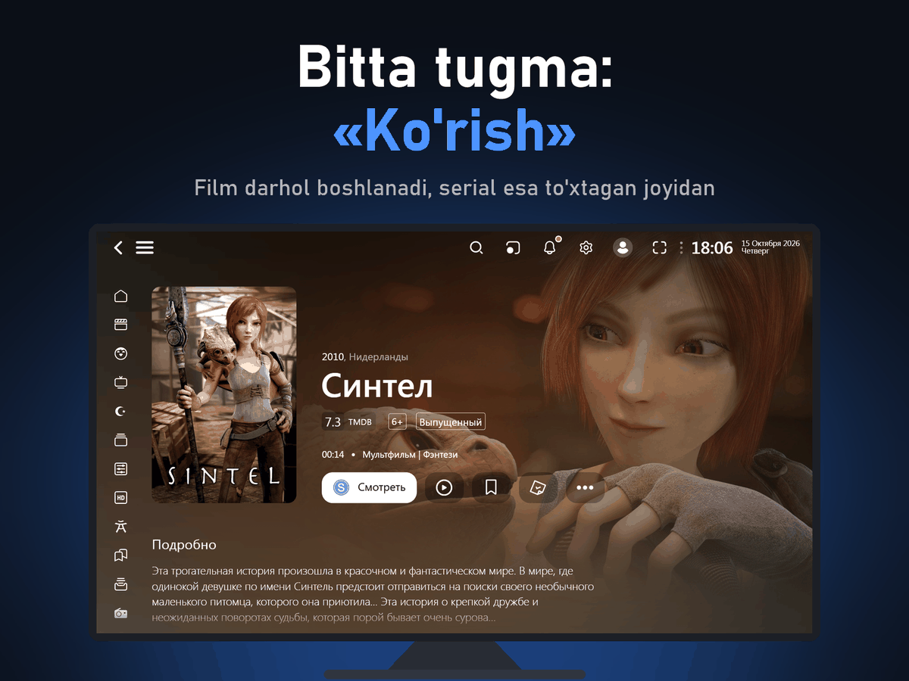
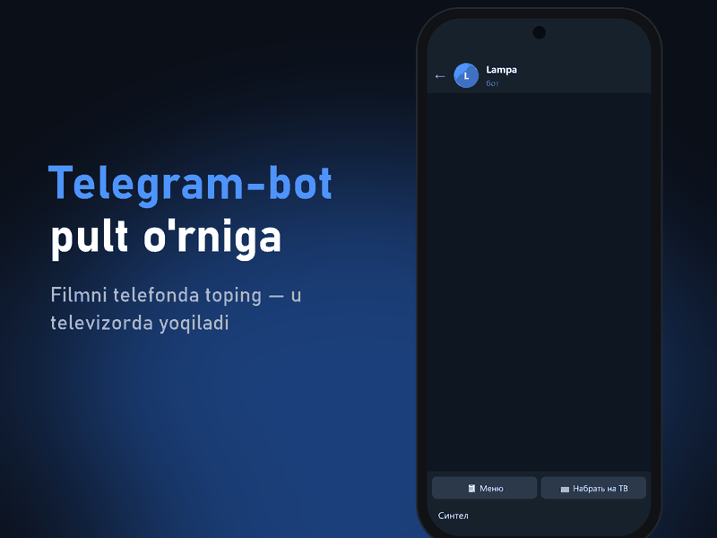
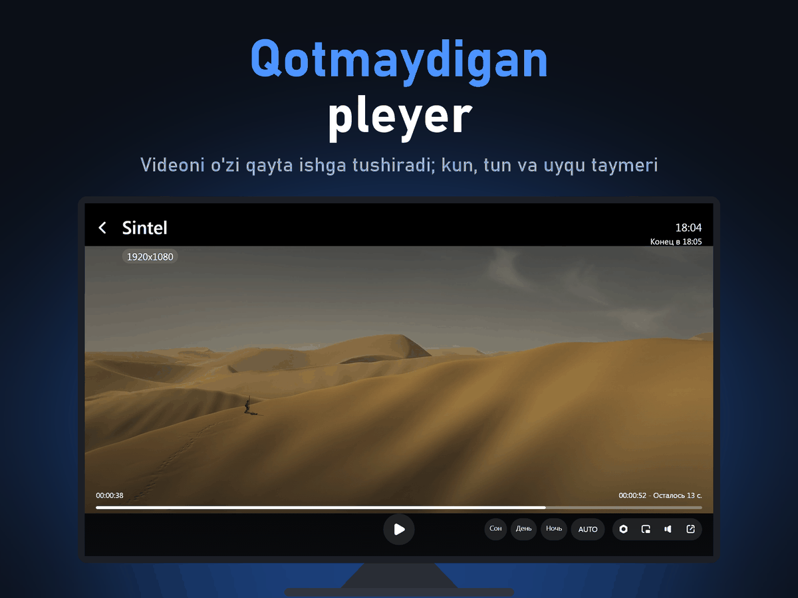
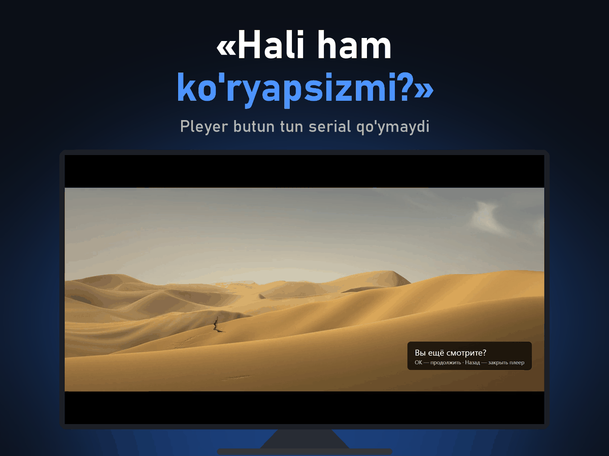
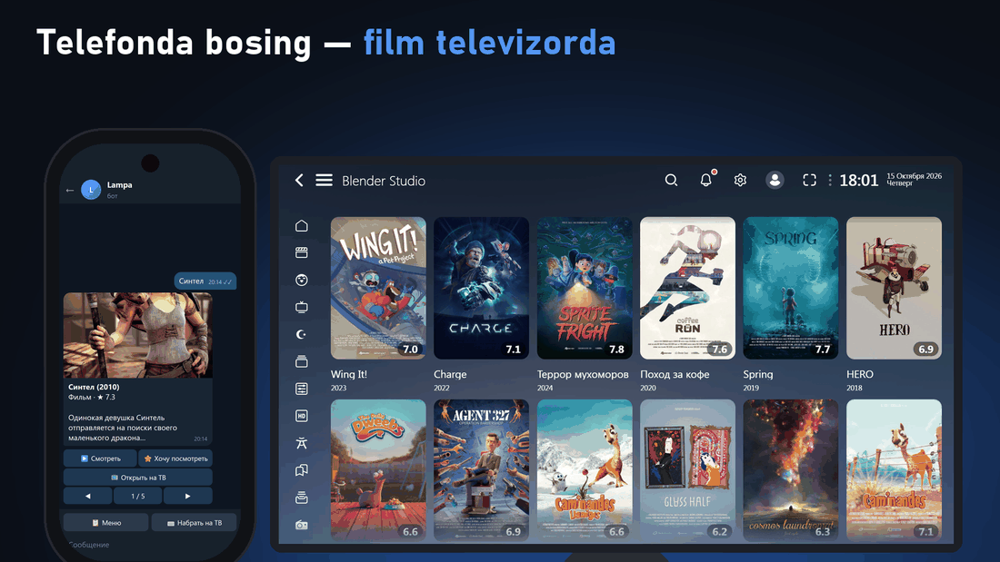
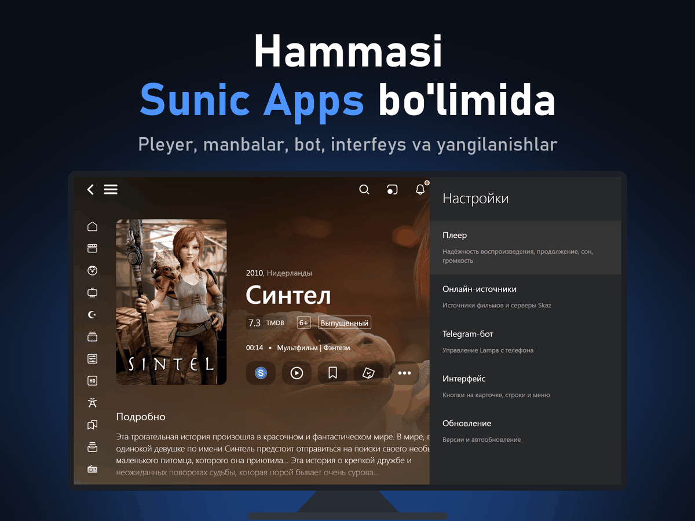
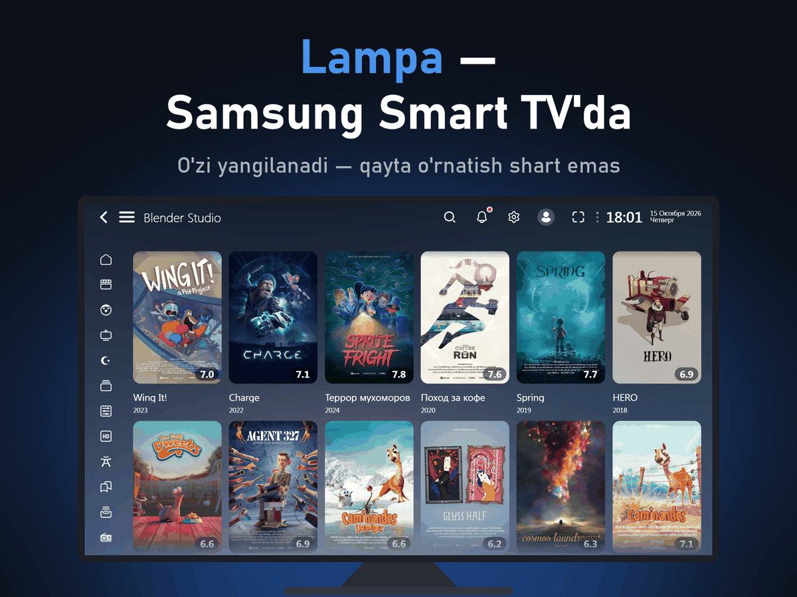
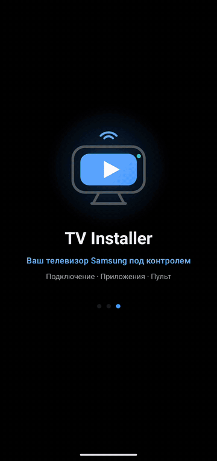
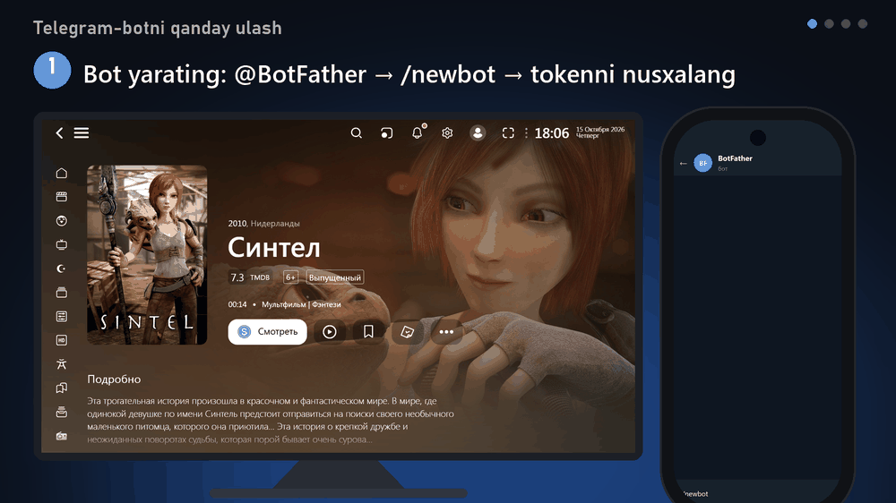

<picture></picture>

<b>Samsung Smart TV</b> uchun ochiq kodli <b>Lampa</b> media markazi. O'zi yangilanadi, pleyer qotib qolmaydi va Telegram-bot qo'shiladi.

<picture></picture>
<picture></picture>

&nbsp;&nbsp;&nbsp;&nbsp;&nbsp;<a href="README.md"> English</a>&nbsp;&nbsp;&nbsp;<a href="README.ru.md"> Русский</a>&nbsp;&nbsp;&nbsp;<picture></picture> <b>O'zbekcha</b>

Bepul · Tizen 2.3+ · <a href="CHANGELOG.md">Yangiliklar</a> (RU) · <a href="../docs/DEVELOPMENT.md">Dasturchilar uchun</a> (RU)

 

## Qanday ishlaydi

1. <b>Televizorni tayyorlang</b> — dasturchi rejimini telefon manzili bilan yoqing (qanday qilish — <a href="https://github.com/sunic007/tvinstaller">TV Installer</a>'da).
2. <b>Lampa'ni o'rnating</b> — TV Installer'da Lampa'ni tanlang yoki <code>samsung.wgt</code>ni yuklab olib, paketni imzolaydigan istalgan o'rnatuvchi bilan o'rnating.
3. <b>Lampa'ni ishga tushiring</b> — boshlang'ich sozlamalarni paket o'zi qo'yadi va keyin o'zi yangilanadi.
4. <b>Telegram-botni ulang</b> (xohishga ko'ra) — <b>Настройки → Sunic Apps → Telegram-бот</b>.

  <picture></picture>
  
  <picture></picture>
  <picture></picture>

<picture></picture>

<b>Ko'proq skrinshotlar</b>

 

  <picture></picture>
  <picture></picture>

Skrinshotlarda faqat Blender Foundation'ning ochiq filmlari (Sintel, Spring, Wing It! va boshqalar) — Creative Commons Attribution litsenziyasi ostida: © Blender Foundation | studio.blender.org. Mualliflik huquqlari buzilmaydi.

## O'rnatish va ulash

  <picture></picture>
  <picture></picture>

Chapda — Lampa'ni TV Installer orqali o'rnatish, o'ngda — Telegram-botni ulash.

<b>TV Installer</b> — Lampa'ni o'rnatishning eng oson yo'li: Android ilova televizorni o'zi topadi, Samsung sertifikatini oladi va oxirgi versiyani o'rnatadi. Kompyuter kerak emas. 
<a href="https://github.com/sunic007/tvinstaller/releases/latest/download/SunicTvInstaller.apk"><b>TV Installer'ni yuklab olish →</b></a>

 

## Imkoniyatlar

- <b>Bitta tugma bilan «Ko'rish»</b> — film darhol boshlanadi, serial esa to'xtagan qism va joyidan davom etadi.
- <b>Telegram-bot</b> — telefonda qidirish va televizorda yoqish, yangi qismlar haqida xabar, butun oila bitta botda, bir nechta televizor.
- <b>Pleyer qo'riqchisi</b> — qotib qolgan videoni o'sha joydan qayta ishga tushiradi, keyin boshqa sifat yoki manbani sinab ko'radi.
- <b>Avtoyangilanish</b> — Lampa, plaginlar va paketning o'zi qayta o'rnatmasdan yangilanadi.
- <b>Samsung pleyeri (AVPlay)</b> — apparat 4K/HLS, tez ishga tushish, internet tezligiga mos sifat.
- <b>Qulaylik</b> — keyingi qismgacha sanoq, «Hali ham ko'ryapsizmi?», uyqu taymeri, kun va tun yorqinligi, har bir film uchun ovoz balandligi.
- <b>Serversiz ham ishlaydi</b> — Lampa serveri ishlamasa, ichki nusxasi ishga tushadi.
- <b>Hammasi bir joyda</b> — paketning barcha sozlamalari — <b>Настройки → Sunic Apps</b> bo'limida.

<b>Bepul AI qidiruv.</b> CUB obunasi yo'qmi? Botdagi tavsif va skrinshot bo'yicha qidiruv <a href="https://console.groq.com/keys">Groq</a>, <a href="https://aistudio.google.com/apikey">Gemini</a> yoki <a href="https://openrouter.ai/keys">OpenRouter</a>ning bepul kaliti bilan ishlaydi — kalitni botga yuboring.

 

Telegram-bot o'zbek, rus va ingliz tillarida gapiradi va Lampa tiliga moslashadi; paketning televizordagi sozlamalari rus tilida. To'liq jadval — <a href="README.ru.md#возможности">rus tilidagi README</a>'da.

## Kontent manbalari

Paketda filmlar, seriallar va translyatsiyalar yo'q. Nimani ko'rishingiz o'zingiz ulagan manbaga bog'liq — masalan, paket sozlangan <a href="https://skaz.tv">Skaz TV</a> obunasi (yordam: <a href="https://t.me/helpiptv">@helpiptv</a>). Faqat foydalanish huquqingiz bor manbalardan foydalaning.

## Ko'p beriladigan savollar

<b>Video ishga tushmayapti</b>

 

Kuting: video 25 soniyada (pleyer xatosida ~9 soniyada) boshlanmasa, paket oqimni o'zi qayta ishga tushiradi yoki boshqa variantni ochadi. Umuman ishlamasa — <a href="https://skaz.tv">Skaz TV</a> obunasini tekshiring va uning yordam xizmatiga yozing.

<b>Yangilanganini qanday bilaman?</b>

 

Yangilanishdan keyin «Lampa обновлена: X → Y» chiqadi; versiyalar — <b>Настройки → Sunic Apps → Обновление</b>da.

<b>Unda filmlar bormi?</b>

 

Yo'q. Bu pleyer: u hech qanday media kontentni saqlamaydi va tarqatmaydi.

## Ma'lumotlar va maxfiylik

Paket reklama va analitika qo'shmaydi, dasturchi sizning ma'lumotlaringizni olmaydi. Telegram-bot televizoringizda ishlaydi: uning tokeni, siz tasdiqlagan odamlar va ro'yxatlaringiz faqat televizorda saqlanadi. Telefonni ulash ntfy.sh xizmati orqali shifrlangan holda o'tadi. Filmlar haqidagi ma'lumotlar — TMDB'dan. Sun'iy intellekt qidiruvi tavsif yoki skrinshotni faqat kalitini qo'shgan xizmatingizga yuboradi (Groq, Gemini yoki OpenRouter). Lampa'da yoqadigan uchinchi tomon onlayn manbalari ilova ichida ishlaydi — faqat ishonganlaringizni yoqing.

## Loyihadan foydalanish

Paketni o'z loyihangiz, yig'mangiz, maqola yoki videongizda ishlatmoqchimisiz? Marhamat — faqat <b>ushbu repozitoriyga havolani qoldiring</b>. <b>Xabar bersangiz</b>, xursand bo'laman (ixtiyoriy): <a href="https://t.me/sunicapps">Telegram guruhiga</a> yozing yoki <a href="https://github.com/sunic007/lampa-samsung/issues/new/choose">issue</a> oching. Kod MIT litsenziyasi ostida (Lampa'ning o'zi — o'z litsenziyasi bilan, THIRD_PARTY_NOTICES'ga qarang).

## Loyihani qo'llab-quvvatlash

Lampa for Samsung va TV Installer bepul. Foydali bo'lsa, rivojlanishini <a href="https://github.com/sponsors/sunic007"><b>GitHub Sponsors</b></a> orqali qo'llab-quvvatlashingiz mumkin.

---

Loyiha filmlar, seriallar va boshqa materiallarni saqlamaydi, joylashtirmaydi va tarqatmaydi hamda u bilan ishlatilishi mumkin bo'lgan kontent xizmatlari bilan bog'liq emas. Samsung va Tizen — Samsung Electronics'ning savdo belgilari; loyiha Samsung bilan bog'liq emas va u tomonidan tasdiqlanmagan. Telegram — Telegram FZ-LLC'ning savdo belgisi; loyiha Telegram bilan bog'liq emas. Filmlar ma'lumotlari va rasmlari — <a href="https://www.themoviedb.org">TMDB</a>: ushbu mahsulot TMDB API'dan foydalanadi, lekin TMDB tomonidan tasdiqlanmagan yoki sertifikatlanmagan. Lampa — <a href="https://github.com/yumata/lampa">yumata/lampa</a> loyihasi, plaginlar va server — <a href="https://lampabs.com">byskaz</a>; bu paket ularni o'zgartirmaydi. Uchinchi tomon litsenziyalari — <a href="../licenses/THIRD_PARTY_NOTICES.md">THIRD_PARTY_NOTICES.md</a>.

